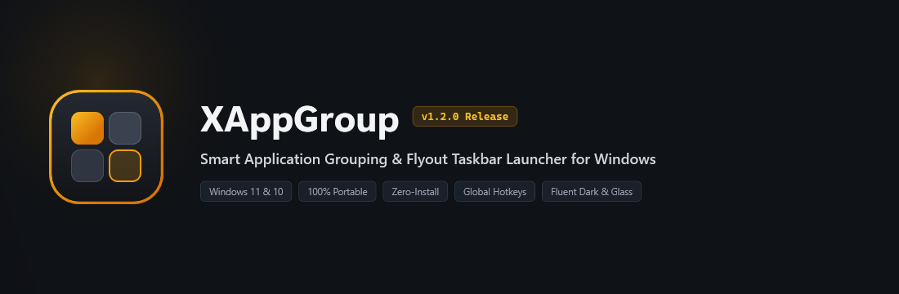
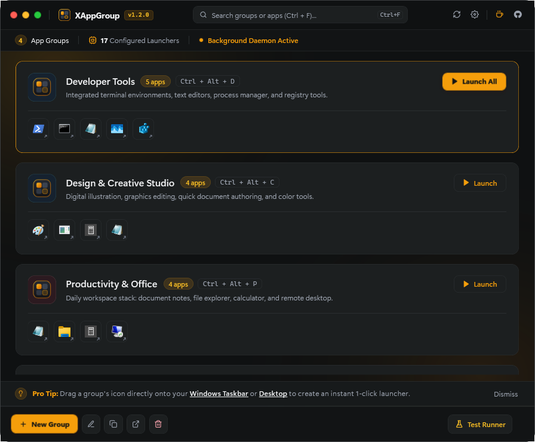
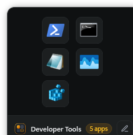
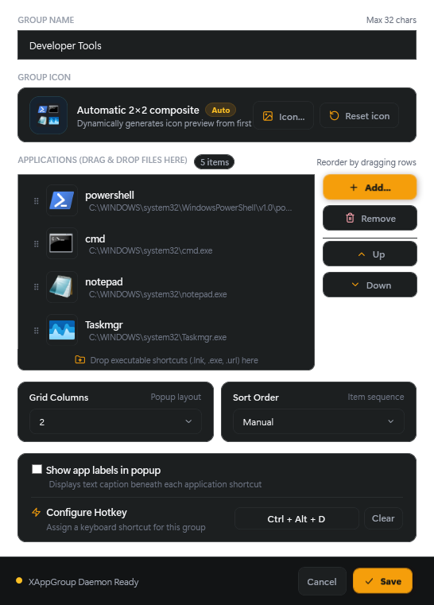
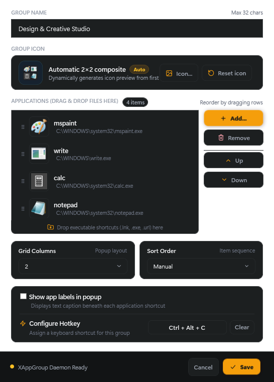

  

  
  
  
  
  

  <b>Declutter your Windows workspace. Group related applications into sleek, animated flyout launchers pinned right to your Taskbar or Desktop.</b>

---

## 🌟 Overview

**XAppGroup** is a lightweight, modern Windows utility designed to organize and streamline your workflow. Instead of crowding your taskbar and desktop with dozens of individual shortcuts, XAppGroup allows you to group related tools—such as *Dev Tools*, *Media Production*, *Office Suites*, or *Gaming Hubs*—into unified, compact launcher pods with custom icons, global hotkeys, and native Windows taskbar integration.

---

## ✨ Key Features

### 📌 Taskbar & Desktop Group Pinning
- Pin multi-app groups directly to your Windows Taskbar as a single high-definition icon.
- Create matching Desktop shortcuts that launch directly into your group flyout.
- Native drag-and-drop support: drag files, apps, or `.lnk` shortcuts directly into any group.

### ⚡ Smooth Elevated Flyout Launcher
- Beautiful bottom-up animated launcher with physics-based quintic easing (`260ms`).
- Direct single-click app launching or one-click **"Launch All"** to boot entire workflows simultaneously.
- Floating footer displaying group metadata, app count, and instant edit shortcuts.

### 🖱️ Custom Taskbar Jump Lists
- Right-click any pinned group icon on your Windows Taskbar to access contextual Jump List commands:
  - 🚀 **Open All Applications**
  - ✏️ **Edit this Group**
- Distinct AppUserModelIDs ensure the main manager and individual groups have completely independent taskbar behaviors.

### ⌨️ Global Win32 Hotkeys
- Bind custom system-wide keyboard shortcuts (e.g. <kbd>Ctrl</kbd> + <kbd>Alt</kbd> + <kbd>D</kbd>) to any group.
- Trigger and summon flyouts instantly from anywhere in Windows, even while inside full-screen apps or games.

### 🎨 Fluent Obsidian & Light Glass Themes
- Handcrafted modern UI styled with **Obsidian Dark** (`#141718`) and **Light Glass** aesthetics.
- Subtle Amber Gold (`#F59E0B`) accents, smooth toggle switches, and customizable backdrop blur effects.
- Unified brand squircle icon dynamically rendered in crisp vector WPF.

### 🧹 Clean Lifecycle & Unpin Automation
- Deleting a group in XAppGroup cleanly unpins it from the Windows Taskbar (`IPinnedList3`), removes desktop shortcuts, unregisters hotkeys, and purges Jump List caches automatically—leaving zero orphaned files behind.

### 🚀 100% Portable & Zero-Install
- No administrative installer, no registry clutter, and zero telemetry.
- Carry your entire application suite and configuration on a USB drive or cloud sync folder.

---

## 📸 Screenshots & Visual Tour

### 1. Main Management Dashboard
Manage, search, launch, reorder, and configure all your application groups with real-time card statistics.

  

### 2. Sleek Taskbar Flyout Launcher
Clicks on pinned taskbar icons smoothly slide up an elevated flyout launcher right above your taskbar.

  

### 3. Comprehensive Group Editor (Dark Obsidian & Light Glass)
Customize group names, icons, global hotkeys, and add/remove applications with instant live preview.

  
  &nbsp;
  

---

## 🚀 Quick Start Guide for Users

1. **Download:** Grab the latest `XAppGroup-v1.2.0-win-x64.zip` from [GitHub Releases](https://github.com/gtools-ba/XAppGroup/releases).
2. **Extract:** Unzip the archive into any folder (e.g. `C:\Tools\XAppGroup` or `Desktop`).
3. **Run:** Double-click `XAppGroup.exe`.
4. **Pin:** Create a group, click **Create Shortcut** or drag to Taskbar, and enjoy organized one-click launching!

### System Requirements:
- **OS:** Windows 10 (version 19041+) or Windows 11 (64-bit).
- **Runtime:** Microsoft [.NET 10 Desktop Runtime](https://dotnet.microsoft.com/download/dotnet/10.0) (free download from Microsoft).

---

## 🛠️ Technology Stack & Architecture

- **UI Framework:** WPF (Windows Presentation Foundation) with hardware-accelerated Direct3D rendering.
- **Target Runtime:** .NET 10.0 (`net10.0-windows`).
- **Win32 & Shell Integration:**
  - `IPinnedList3` for programmatic taskbar pin/unpin automation.
  - `ICustomDestinationList` for native Windows Jump List task verbs.
  - `RegisterHotKey` with message-only `HWND_MESSAGE` listener for conflict-free global hotkeys.
  - Windows Registry `HKCU\Software\Microsoft\Windows\CurrentVersion\Run` for optional startup.
- **Code Quality:** Fully verified with **49 automated self-tests** covering headless rendering, data persistence, shortcut lifecycle, and Win32 shell interop.

---

## 💖 Support the Developer

**XAppGroup is 100% free and open source!** 

If XAppGroup helps you declutter your desktop, saves you time, and improves your daily Windows workflow, please consider supporting the project and buying the creator a coffee:

  

- ⭐ **[Star this repository on GitHub](https://github.com/gtools-ba/XAppGroup)** to help more people discover it!
- ☕ **[Buy me a coffee on Ko-fi](https://ko-fi.com/xgroup)** to support continuous updates and future features!
- 🐛 **Found a bug or have a suggestion?** Open an [Issue](https://github.com/gtools-ba/XAppGroup/issues) on GitHub.

---

  XAppGroup • Designed with precision for Windows • Licensed under MIT

